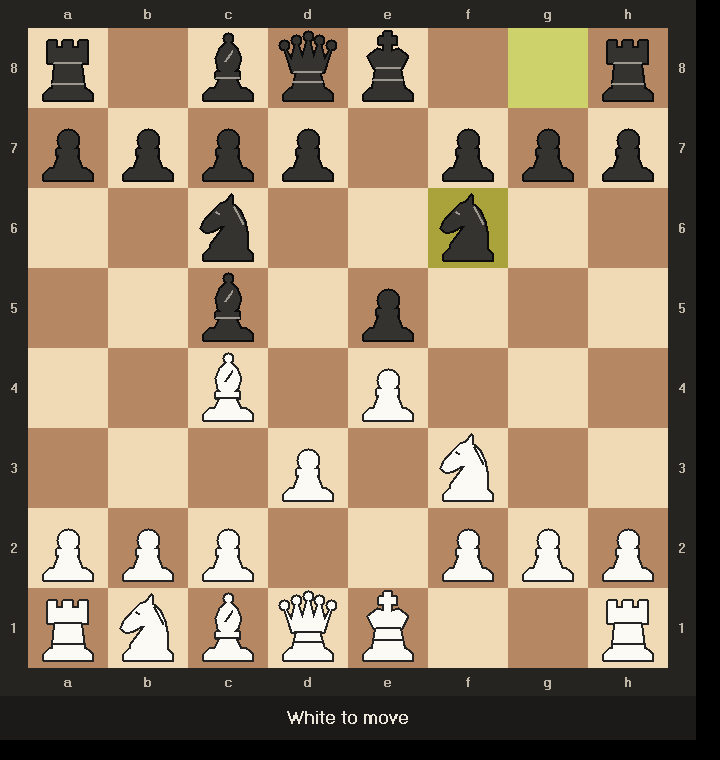

# Game of Chess

A complete chess game in C++17 for the terminal and X11. You can play human vs human,
human vs computer, or watch computer vs computer. There are four computer levels; the
strongest is a real alpha-beta engine.

Originally a CS246 (Fall 2023) group project by Justin Yu, Germain Zhang and Spike Wang.
This version keeps the original MVC class design (see `design.pdf` / `uml-final.pdf`) and
rewrites the internals so that the game is correct, fast and smooth.



## Build & run

```bash
make            # needs g++ and Xlib (Linux: libx11-dev, macOS: XQuartz)
./chess         # graphics window + text board
./chess -text   # text only
make test       # move-generator (perft) and opening-book tests
```

Options: `-enablebonus` (turns on undo / redo / hint), `-text`, and `-time <ms>` (how long
computer4 thinks per move; the default is 1200).

## Commands

| command | meaning |
|---|---|
| `game <white> <black>` | start a game; players: `human`, `computer1` … `computer4` |
| `move e2 e4` | make a move (`move e2e4` also works) |
| `move e7 e8 Q` | promote (the piece is optional and defaults to a queen) |
| `move` | let the computer move. In human-vs-computer games it replies automatically. |
| `play` | play a computer-vs-computer game to the end |
| `resign` | concede the game |
| `setup` | build a position: `+ K e1`, `- e1`, `= black`, `default`, `clear`, `done` |
| `undo` / `redo` / `hint` | bonus features (need `-enablebonus`) |
| `board`, `help`, `quit` | reprint the board, show help, quit |

When input ends (Ctrl-D or `quit`), the final score is printed. A win counts as 1 and a draw
as ½ for each side.

## Computer levels

| level | strategy |
|---|---|
| 1 | random legal move |
| 2 | prefers checkmate, then captures (bigger pieces first) and checks |
| 3 | 2-ply search plus a capture search: avoids hanging pieces, takes free material, likes checks |
| 4 | opening book, then an iterative-deepening alpha-beta engine (about 10–13 plies in a middlegame at 1.2 s) |

Level 4 uses principal variation search, a transposition table with Zobrist hashing, and a
quiescence search. It extends the search when in check. Moves are ordered by hash move,
MVV-LVA, killer moves and the history heuristic. It prunes with null moves, late-move
reductions and reverse futility. Its evaluation is tapered between middlegame and endgame. It
scores piece-square tables, passed, doubled and isolated pawns, rooks on open files, the bishop
pair and king shelter, and it uses mop-up knowledge to finish K+Q and K+R mates.

In self-play with alternating colours, each level beat the level below it: 2 vs 1 went 4–0
with 2 draws, 3 vs 2 went 6–0, and 4 vs 3 went 6–0.

## Architecture (MVC, unchanged from the design document)

- **Model:** `Piece` (abstract) → `King`, `Queen`, `Rook`, `Bishop`, `Knight`, `Pawn`,
  `Empty`. Each piece generates its own moves. `Board` owns the 8×8 grid of pieces and knows
  the full rules: check, castling rights, en passant, promotion, the fifty-move rule,
  threefold repetition and insufficient material. It applies moves in place
  (`makeMove`/`undoMove`), which is what makes both undo and the engine's search fast.
  `Move` describes one move.
- **View:** `Textdisplay` prints the standard board. `Graphdisplay` draws the board with
  `Xwindow`.
- **Controller:** `Gamecontroller` holds the board, the views, the `Scoreboard`, the players
  and the undo/redo stacks. `Player` → `Human` / `Computer`, and `Computer` uses an
  `Algorithm` (strategy pattern) → `Level1`…`Level4`. `OpeningBook` is the weighted move
  tree described in the design document.

## What changed compared with the 2023 version

- **It builds.** The old code did not compile: there were missing declarations, private
  access from `Level4`, and `std::random_shuffle`.
- **Rules are correct and verified by perft.** The code reproduces the reference move counts
  for 8 standard test positions, including the tricky Kiwipete and promotion positions.
  The old code had several rule bugs:
  - black castling marked the wrong rook as moved;
  - en passant set the "promotion" flag;
  - `dopossiblemoves2` compared `turn == "Black"` instead of assigning it;
  - the threat scan mixed up rows and columns;
  - checkmate printed the losing side as the winner;
  - setup `= colour` always failed;
  - setup was erased when `game` started.
- **Stalemate and draws are now detected:** the fifty-move rule, threefold repetition and
  insufficient material. The old `isdraw` was never called.
- **It is fast.** The old code copied a heap-allocated piece for every square lookup and
  copied the whole board for every check test. The board now updates in place and keeps a
  `char` mirror for lookups (about 12 M legal moves/s in perft). The 1,500 lines of
  duplicated `Gamecontroller` code shrank to about 400.
- **Graphics:**
  - drawn vector pieces replace the coloured rectangles labelled "Rook"/"Pawn";
  - a wooden board with coordinates;
  - the last move and a king in check are highlighted;
  - a status bar shows whose turn it is and "thinking…";
  - frames are double-buffered and only changed squares are redrawn, so nothing flickers;
  - the window repaints itself when it is uncovered;
  - closing the window keeps the game running in text mode, and without an X display the
    program falls back to text mode instead of exiting.
- **Usability:**
  - the computer replies automatically;
  - illegal moves get a clear reason;
  - promotion defaults to a queen;
  - the bonus features undo, redo and hint were added;
  - the old debug prints ("pawn.cc 37", "16", "28", …) were removed;
  - there is a Makefile.
- **Memory:** no raw `new`/`delete` remain (`Computer` owned its algorithm through a raw
  pointer, and `Player` had no virtual destructor). The code runs clean under AddressSanitizer
  and UBSan.
